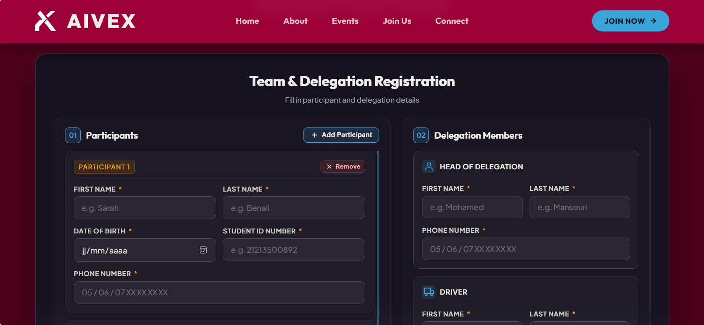
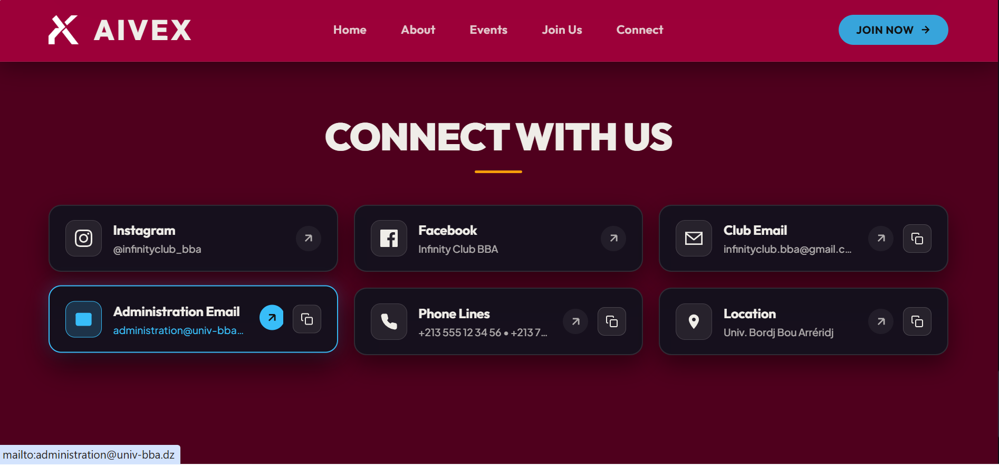
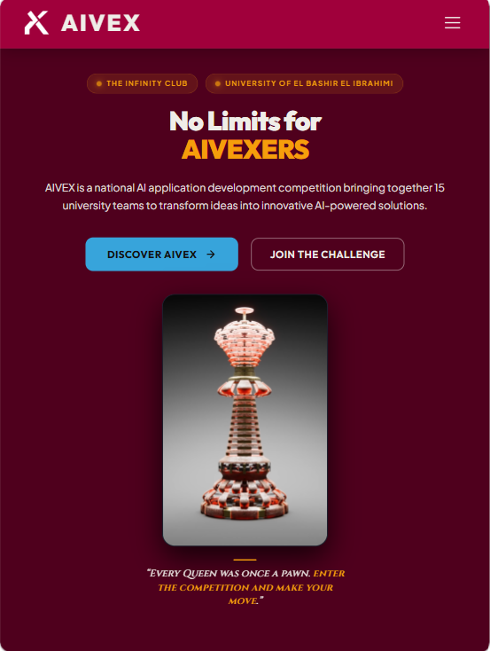
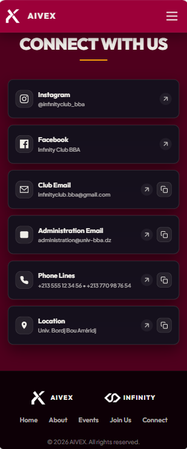

<div align="center">

# 🏆 AIVEX — National AI Innovation & Development Tournament

**Official competition website organized by Infinity Club — Faculty of MI, University of El Bashir El Ibrahimi (BBA).**  
*15 university teams · 3 days · 1 AI challenge.*

[](https://react.dev/)
[](https://threejs.org/)
[](https://www.blender.org/)
[](https://supabase.com/)
[](https://vite.dev/)
[](LICENSE)

</div>

---

## 📸 Preview

### Desktop

| Aivex competition information | Team & Delegation Registration | Connect With Us |
| :---: | :---: | :---: |
|  |  |  |

### Responsive Design

| **Tablet — Hero** | **Tablet — Mobile Nav & Cards** |
| :---: | :---: |
|  |  |

| **Mobile — Hero** | **Mobile — Connect & Footer** |
| :---: | :---: |
|  |  |

---

## ✨ Features

- ♾️ **Hand-crafted 3D Queen & Pawn** — Fully modeled, sculpted, textured, and animated in Blender, rendered smoothly in real-time with Three.js (WebGL, smooth vertex normals, gold rim lighting, and studio shadows).
- 🎬 **Pawn-to-Queen Transformation** — Embedded video animation honoring the competition's motto: *"Every Queen was once a pawn. Enter the competition and make your move."*
- 🃏 **Flipping Event Cards** — Interactive CSS 3D cards that flip 180° on hover to reveal timeline stages and schedule details for the AIVEX tournament.
- 📋 **Team & Delegation Registration** — Dynamic multi-participant registration system with real-time validation and persistent storage powered by Supabase.
- 📱 **Fully Responsive Layout** — Fluid presentation across widescreen desktops, tablets, and smartphones with an animated mobile navigation drawer.
- 🔗 **Interactive Connect Section** — One-click clipboard copy for email addresses and phone lines, plus quick navigation to campus location and social media channels.

---

## 🛠️ Tech Stack

| Layer | Technology | Description |
|---|---|---|
| **Frontend Framework** | **React 19** | Component-driven architecture and hooks-based state management |
| **3D Modeling & Animation** | **Blender** | High-precision mesh sculpting, PBR materials, and animation |
| **3D Web Rendering** | **Three.js (r185)** | GLTFLoader, OrbitControls, custom multi-point lighting, and ACESFilmic tone mapping |
| **Backend & Database** | **Supabase** | Cloud database persistence for registrations via `@supabase/supabase-js` |
| **Build Tooling** | **Vite 8** | High-speed bundler with Fast Refresh (HMR) |
| **Styling** | **Pure CSS3** | Custom design system using CSS variables, 3D perspective transforms, and glassmorphism |

---

## ⚙️ Technical Highlights

- 🧊 **Custom 3D Blender Pipeline**: The signature mechanical chess pieces were sculpted and animated from scratch in Blender, exported as binary `.glb` containers, and rendered in the browser with `GLTFLoader` and `AnimationMixer`.
- 💡 **Dynamic Lighting & Shaders**: Studio-grade lighting setup featuring ambient illumination, directional key light with PCF soft shadows, warm gold rim highlights, and ACESFilmic tone mapping.

---

## 📂 Project Structure

```text
infinity-club/
├── public/
│   ├── images/              # Logos, sponsor badges & UI assets
│   ├── models/              # Blender 3D GLTF/GLB models (queen.glb, etc.)
│   └── videos/              # Transformation video animations
├── src/
│   ├── assets/              # Showcase previews and screenshots
│   ├── lib/
│   │   └── SupabaClient.js  # Supabase client initialization
│   ├── App.css              # Custom styling, 3D card flips, responsive styles
│   ├── App.jsx              # Main application, Navbar, Hero, Events, Registration
│   ├── Queen3d.jsx          # Standalone Three.js 3D canvas component
│   ├── index.css            # Global resets and CSS variables
│   └── main.jsx             # React DOM root entry
├── package.json             # Dependencies and scripts
└── vite.config.js           # Vite configuration
```

---

## 🚀 Running Locally

### Prerequisites

- [Node.js](https://nodejs.org/) (version 18 or newer recommended)
- [npm](https://www.npmjs.com/) or [pnpm](https://pnpm.io/)

### Installation & Setup

1. **Clone the repository:**
   ```bash
   git clone https://github.com/Alae-bng/cometition.git
   cd cometition/infinity-club
   ```

2. **Install dependencies:**
   ```bash
   npm install
   ```

3. **Configure Environment Variables:**
   Create a `.env` file in the `infinity-club` directory (or use `.env.example`):
   ```env
   VITE_SUPABASE_URL=your_supabase_project_url
   VITE_SUPABASE_ANON_KEY=your_supabase_anon_key
   ```

4. **Start the development server:**
   ```bash
   npm run dev
   ```

5. **Build for production:**
   ```bash
   npm run build
   ```

---

## 📄 License

This project is open-source and licensed under the [MIT License](LICENSE).
